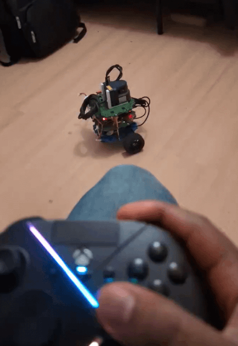
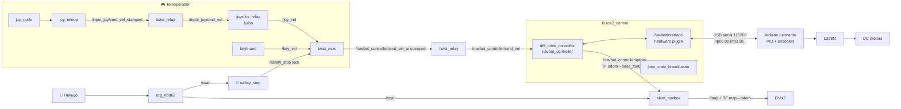

<div align="center">

# 🤖 NavBot: Autonomous Mapping & Localization with ROS 2 and SLAM

**A differential-drive robot built from scratch that maps rooms in real time with a Hokuyo LiDAR, SLAM Toolbox and ROS 2.**

[](https://docs.ros.org/en/humble/)
[](https://releases.ubuntu.com/22.04/)
[](https://www.raspberrypi.com/)
[](https://docs.arduino.cc/hardware/leonardo/)
[](#)
[](#)
[](LICENSE)


</div>

---

## 📑 Table of Contents

- [Overview](#-overview)
- [Demo](#-demo)
- [Features](#-features)
- [Hardware](#-hardware)
- [System Architecture](#-system-architecture)
- [Workspace Packages](#-workspace-packages)
- [Installation](#-installation)
- [Usage](#-usage)
- [Simulation](#-simulation-gazebo)
- [Configuration Reference](#-configuration-reference)
- [Troubleshooting](#-troubleshooting)
- [Roadmap](#-roadmap)
- [Acknowledgements](#-acknowledgements)
- [License](#-license)

---

## 🔭 Overview

**NavBot** is a small autonomous mobile robot I designed, wired and programmed end to end. It runs **ROS 2 Humble** on a **Raspberry Pi 4**. An **Arduino Leonardo** runs a closed-loop PID speed controller for each wheel, and a **Hokuyo 2D LiDAR** feeds **SLAM Toolbox**, which builds an occupancy-grid map of the environment as you drive the robot with a gamepad.

The project covers the full robotics stack:

| Layer | What runs there |
|---|---|
| **Firmware** | Arduino PID speed control, quadrature encoder reading, serial protocol |
| **Hardware abstraction** | Custom `ros2_control` `SystemInterface` plugin (C++) that talks to the Arduino over USB serial |
| **Control** | `diff_drive_controller` for odometry and wheel commands, plus `twist_mux` with priority-based teleoperation |
| **Safety** | A LiDAR-based safety stop that slows the robot in a warning zone and stops it in a danger zone |
| **Perception & mapping** | `urg_node2` → `/scan` → `slam_toolbox` → `/map` |
| **Localization** | AMCL on a saved map, an EKF (`robot_localization`), and hand-written Kalman filter and motion-model nodes |
| **Simulation** | Gazebo (Ignition) worlds of a house and a warehouse, with the same controllers and SLAM pipeline |

---

## 🎬 Demo

<table>
  <tr>
    <td align="center"><b>Live SLAM on the real robot</b></td>
    <td align="center"><b>Joystick teleoperation</b></td>
  </tr>
  <tr>
    <td></td>
    <td></td>
  </tr>
</table>

**Map built by the real robot** (RViz2: map, laser scan and TF frames):


**The same pipeline in simulation:** Gazebo `small_house` world (left) and the map from SLAM Toolbox in RViz2 (right):


---

## ✨ Features

- 🛞 **Custom `ros2_control` hardware interface** (`navbot_firmware/NavbotInterface`). It exports position and velocity state interfaces and velocity command interfaces for both wheels.
- 🎛️ **Per-wheel PID speed control** on the Arduino, using the `PID_v1` library and encoder feedback every 100 ms.
- 🧭 **Wheel odometry** from `diff_drive_controller`, published on `/navbot_controller/odom` with the `odom → base_footprint` transform.
- 🗺️ **Online SLAM** with `slam_toolbox` (5 cm resolution, loop closure enabled), plus a `map_saver_server` for saving maps.
- 📍 **Global localization** with Nav2 `map_server` and `amcl` on a previously saved map.
- 🎮 **Gamepad teleoperation** through `joy`, `joy_teleop` and `twist_mux`, with a deadman button and turbo speed steps.
- 🛑 **LiDAR safety stop.** It slows down below 0.6 m and stops below 0.2 m, and shows both zones as RViz markers on `/zones`.
- 🧪 **Gazebo simulation.** The same URDF switches between the real and simulated hardware with an `is_sim` xacro argument.
- 📚 **Learning packages** with hand-written Kalman filter, odometry motion model, mapping-with-known-poses and ROS 2 concept examples in Python and C++.

---

## 🔧 Hardware

| Component | Part | Role |
|---|---|---|
| 🧠 Main computer | **Raspberry Pi 4 Model B** | Runs ROS 2 Humble (Ubuntu 22.04, aarch64), reached over SSH / Wi-Fi |
| ⚡ Microcontroller | **Arduino Leonardo** | Wheel PID control and encoder reading, connected over USB serial at `115200` baud |
| 🔌 Motor driver | **L298N** dual H-bridge | Drives both DC motors |
| ⚙️ Motors | 2 × DC gear motors with quadrature encoders | 385 encoder pulses per wheel revolution (as configured in firmware) |
| 📡 LiDAR | **Hokuyo URG-series ("Rapid", UBG-04LX-F01)** | 2D laser scans through `urg_node2` |
| 🔋 Power | LiPo battery pack (XT60) | Powers the motors through the L298N |
| 🎮 Controller | Xbox-style gamepad | Teleoperation |
| 🧱 Chassis | 3D-printed stacked plates, 2 drive wheels plus front and rear casters | Wheel radius **0.033 m**, wheel separation **0.17 m** |

### Arduino wiring

| Signal | Leonardo pin | L298N / encoder |
|---|---|---|
| Right motor PWM | `9` | `ENA` |
| Right motor direction | `12`, `13` | `IN1`, `IN2` |
| Left motor PWM | `11` | `ENB` |
| Left motor direction | `7`, `8` | `IN3`, `IN4` |
| Right encoder phase A (interrupt) | `3` | Encoder A |
| Right encoder phase B | `5` | Encoder B |
| Left encoder phase A (interrupt) | `2` | Encoder A |
| Left encoder phase B | `4` | Encoder B |
| Encoder power | `5V` | Encoder VCC |
| Encoder ground | `GND` | Encoder GND |

> [!IMPORTANT]
> - Power the encoders from **5V**, not 3.3V, and connect their **GND to the Arduino GND**. Without a shared ground the Arduino reads no pulses at all.
> - Each motor must be on the **same side** as its own encoder. If the motor wires are swapped between `OUT1/OUT2` and `OUT3/OUT4`, each PID loop reads the wrong wheel and only one wheel drives at a time.
> - Encoder phase A must be on an interrupt-capable pin. On the Leonardo those are pins 0, 1, 2, 3 and 7.

---

## 🏗️ System Architecture



### Serial protocol (Raspberry Pi ⇄ Arduino)

Both directions use the same compact ASCII format. Each wheel gets a letter (`r` or `l`), a sign (`p` for positive, `n` for negative) and a speed in **rad/s**:

```text
Pi → Arduino (command):   rp05.00,ln03.50,     right +5.00 rad/s, left −3.50 rad/s
Arduino → Pi (feedback):  rp4.98,ln3.47,       measured speeds, sent every 100 ms
```

The hardware interface integrates the measured speeds into wheel positions, which `diff_drive_controller` turns into odometry.

---

## 📦 Workspace Packages

```text
navbot/src
├── navbot_bringup        # Top-level launch files for the real robot and the simulation
├── navbot_descriptions   # URDF/xacro, meshes, ros2_control tags, Gazebo worlds and models, RViz config
├── navbot_firmware       # Arduino sketches + ros2_control hardware plugin (C++) + IMU driver
├── navbot_controller     # diff_drive config, teleop and twist_mux setup, twist relay, custom controllers
├── navbot_mapping        # slam_toolbox config/launch, saved maps, mapping-with-known-poses node
├── navbot_localization   # AMCL, EKF, Kalman filter, odometry motion model, IMU republisher
├── navbot_utils          # LiDAR safety stop (Python + C++)
├── navbot_msgs           # Custom service and action definitions
├── sensor_fusion         # IMU and IMU + odometry fusion experiments
├── navbot_examples       # ROS 2 concept examples (Python)
├── navbot_cpp_examples   # ROS 2 concept examples (C++)
└── urg_node2             # Hokuyo LiDAR driver (third-party, Apache-2.0)
```

<details>
<summary><b>Key files</b></summary>

| File | Purpose |
|---|---|
| `navbot_bringup/launch/real_robot.launch.py` | Starts the hardware, LiDAR, controllers, joystick and safety stop, plus SLAM **or** AMCL |
| `navbot_bringup/config/hokuyo.yaml` | LiDAR serial port (by-id path), frame and scan angles |
| `navbot_firmware/src/navbot_interface.cpp` | `ros2_control` hardware plugin that speaks the serial protocol |
| `navbot_firmware/firmware/robot_control/robot_control.ino` | Main Arduino firmware with PID and encoders |
| `navbot_controller/config/navbot_controllers.yaml` | `diff_drive_controller` parameters and limits |
| `navbot_controller/config/twist_mux_*.yaml` | Command priorities, safety lock and turbo steps |
| `navbot_mapping/config/slam_toolbox.yaml` | SLAM Toolbox parameters |
| `navbot_localization/config/amcl.yaml` | AMCL parameters |
| `navbot_utils/navbot_utils/safety_stop.py` | Warning and danger zone logic |
| `navbot_descriptions/urdf/navbot.urdf.xacro` | Robot model (`is_sim` switches real or simulated hardware) |

</details>

---

## 🛠️ Installation

### 1. Prerequisites

- Ubuntu 22.04 with [ROS 2 Humble](https://docs.ros.org/en/humble/Installation.html) on the Raspberry Pi (and on your PC if you want RViz or simulation)
- Arduino IDE on a PC, to flash the firmware

### 2. Clone and build

```bash
mkdir -p ~/navbot && cd ~/navbot
git clone https://github.com/Valen-Nneji-007/Autonomous-Robot-Mapping-Localization-with-ROS-2-and-SLAM.git .

sudo apt update
sudo apt install -y libserial-dev python3-serial python3-smbus \
  ros-humble-ros2-control ros-humble-ros2-controllers \
  ros-humble-slam-toolbox ros-humble-navigation2 ros-humble-nav2-bringup \
  ros-humble-robot-localization ros-humble-twist-mux ros-humble-joy-teleop \
  ros-humble-xacro ros-humble-tf-transformations ros-humble-laser-proc
rosdep install --from-paths src --ignore-src -r -y

colcon build --symlink-install
source install/setup.bash
```

Allow your user to open the serial ports, then log out and back in:

```bash
sudo usermod -aG dialout $USER
```

### 3. Flash the Arduino

1. Open `src/navbot_firmware/firmware/robot_control/robot_control.ino` in the Arduino IDE.
2. Install the **PID** library by Brett Beauregard (*Tools → Manage Libraries → "PID"*).
3. Choose **Tools → Board → Arduino Leonardo** and the matching port, then click **Upload**.

> [!TIP]
> Enable the internal pull-ups on the encoder pins for clean readings:
> ```cpp
> pinMode(right_encoder_phaseA, INPUT_PULLUP);
> pinMode(right_encoder_phaseB, INPUT_PULLUP);
> pinMode(left_encoder_phaseA,  INPUT_PULLUP);
> pinMode(left_encoder_phaseB,  INPUT_PULLUP);
> ```

### 4. Check the serial devices

```bash
ls -l /dev/serial/by-id/
# usb-Arduino_LLC_Arduino_Leonardo-if00                      -> ../../ttyACM0
# usb-Hokuyo_Data_Flex_for_USB_URG-Series_USB_Driver-if00    -> ../../ttyACM1
```

The LiDAR is opened by its stable `by-id` path. The Arduino port is set in `navbot_descriptions/urdf/navbot_ros2_control.xacro` (`/dev/ttyACM0` by default).

---

## 🚀 Usage

### Build a map (SLAM)

On the **Raspberry Pi**:

```bash
cd ~/navbot && source install/setup.bash
ros2 launch navbot_bringup real_robot.launch.py use_slam:=true
```

On your **PC** (same network and same `ROS_DOMAIN_ID`):

```bash
rviz2 -d ~/navbot/src/navbot_mapping/rviz/slam.rviz
```

Set the **Fixed Frame** to `map`, then add the **Map**, **LaserScan** and **TF** displays if they aren't already there.

### Drive with the gamepad

| Control | Action |
|---|---|
| Hold **button 5** (RB on an Xbox pad) | Deadman switch. The robot only moves while it's held |
| **Right stick ↕** (axis 4) | Forward / backward |
| **Right stick ↔** (axis 3) | Rotate |

Drive slowly, especially when turning, and come back to your starting point to help loop closure.

### Save the map

```bash
mkdir -p ~/navbot/src/navbot_mapping/maps/my_house
ros2 run nav2_map_server map_saver_cli -f ~/navbot/src/navbot_mapping/maps/my_house/map
```

### Localize on a saved map (AMCL)

```bash
colcon build --packages-select navbot_mapping   # installs the new map
ros2 launch navbot_bringup real_robot.launch.py map_name:=my_house use_sim_time:=false
```

Without `use_slam:=true`, the bringup starts Nav2 `map_server` and `amcl` instead of SLAM, loading `navbot_mapping/maps/<map_name>/map.yaml`. Then use **2D Pose Estimate** in RViz to give AMCL the robot's starting pose.

---

## 🧪 Simulation (Gazebo)

The same controllers, teleoperation and SLAM run in Gazebo (Ignition Fortress on Humble). Three worlds are included: `empty`, `small_house` and `small_warehouse`.

```bash
# Terminal 1: Gazebo world, robot and controllers
ros2 launch navbot_descriptions gazebo.launch.py world_name:=small_house

# Terminal 2: joystick teleop with twist_mux (use_sim_time is true by default)
ros2 launch navbot_controller joystick_teleop.launch.py

# Terminal 3: SLAM
ros2 launch navbot_mapping slam.launch.py

# Terminal 4: visualization
rviz2 -d $(ros2 pkg prefix navbot_mapping)/share/navbot_mapping/rviz/slam.rviz --ros-args -p use_sim_time:=true
```

---

## ⚙️ Configuration Reference

| Parameter | Value | File |
|---|---|---|
| Controller update rate | 100 Hz | `navbot_controllers.yaml` |
| Wheel radius / separation | 0.033 m / 0.17 m | `navbot_controllers.yaml` |
| Max linear velocity / acceleration | 0.7 m/s / 0.7 m/s² | `navbot_controllers.yaml` |
| Max angular velocity / acceleration | 8.5 rad/s / 5.0 rad/s² | `navbot_controllers.yaml` |
| Command priorities | safety lock 255 > joystick 99 > keyboard 90 | `twist_mux_*.yaml` |
| Safety zones | warning 0.6 m (slows down), danger 0.2 m (stops) | `safety_stop.py` |
| SLAM resolution / max laser range | 0.05 m / 12 m | `slam_toolbox.yaml` |
| LiDAR field of view | −3.14 to +3.14 rad | `hokuyo.yaml` |
| PID gains (right) | Kp 11.5, Ki 7.5, Kd 0.1 | `robot_control.ino` |
| PID gains (left) | Kp 12.8, Ki 8.3, Kd 0.1 | `robot_control.ino` |

---

## 🩺 Troubleshooting

These are real problems I hit while building NavBot, and how I fixed them.

<details>
<summary><b>The map doesn't update when the robot moves</b></summary>

SLAM needs working odometry. Check each layer from the top down:

```bash
ros2 topic echo /navbot_controller/odom                  # does the pose change while driving?
ros2 topic echo /joint_states | grep -A2 velocity        # do both wheels report speed?
```

If the wheel speeds stay at `0.0`, stop the launch and read the Arduino directly:

```bash
python3 -m serial.tools.miniterm /dev/ttyACM0 115200     # exit with Ctrl+]
stty -F /dev/ttyACM0 115200 raw && cat /dev/ttyACM0 | grep --line-buffered -E '[1-9]'   # show only non-zero readings
```

If you only ever see `rp0.00,ln0.00,` while spinning the wheels by hand, the encoders aren't producing pulses. Check the **5V and GND** wiring and enable `INPUT_PULLUP`.
</details>

<details>
<summary><b>"Something went wrong while interacting with port /dev/ttyACM0"</b></summary>

Another process is still holding the port, usually a leftover `ros2_control_node` or a `cat` from testing.

```bash
sudo fuser -v /dev/ttyACM0     # find the PID
kill <PID>
```
</details>

<details>
<summary><b>Only one wheel drives at a time, or one is fast and one is slow</b></summary>

Each motor must be on the same L298N channel as its own encoder. If they're crossed, each PID loop corrects the wrong wheel. Swap the motor wires between `OUT1/OUT2` and `OUT3/OUT4`, then check:

```bash
ros2 topic echo /joint_states | grep -A2 velocity
```

Forward should give both values **positive**, reverse both **negative**, and turning should give opposite signs.
</details>

<details>
<summary><b>The Arduino IDE can't see the board (Windows + WSL)</b></summary>

If the board was attached to WSL with `usbipd`, give it back to Windows from an Administrator PowerShell:

```powershell
usbipd list
usbipd detach --busid <BUSID>
```
</details>

<details>
<summary><b>The robot refuses to move near obstacles</b></summary>

That's the safety stop doing its job. You can shrink the zones with the `danger_distance` and `warning_distance` parameters of `safety_stop.py`, or comment out the `safety_stop` node in `real_robot.launch.py` while mapping tight spaces. If you remove it, drive carefully.
</details>

---

## 🗺️ Roadmap

- [x] Custom `ros2_control` hardware interface for an Arduino-based base
- [x] Closed-loop wheel speed control with encoders
- [x] Joystick teleoperation with a LiDAR safety stop
- [x] Real-time 2D SLAM on the real robot
- [x] Gazebo simulation with house and warehouse worlds
- [ ] AMCL localization on a map of my own home
- [ ] IMU (MPU6050) + wheel odometry fusion with the EKF on the real robot
- [ ] Autonomous navigation with Nav2 (path planning, obstacle avoidance)
- [ ] Autonomous exploration (frontier-based)

---

## 🙏 Acknowledgements

- The **"Self-Driving and ROS 2 – Learn by Doing! Map & Localization"** course (BumperBot project), which inspired the architecture. NavBot adapts it to custom hardware.
- [`slam_toolbox`](https://github.com/SteveMacenski/slam_toolbox), [Nav2](https://github.com/ros-navigation/navigation2), [`ros2_control`](https://github.com/ros-controls/ros2_control) and [`robot_localization`](https://github.com/cra-ros-pkg/robot_localization).
- [`urg_node2`](https://github.com/Hokuyo-aut/urg_node2) by Hokuyo Automatic (Apache-2.0).
- [AWS RoboMaker Small House World](https://github.com/aws-robotics/aws-robomaker-small-house-world) models used in the Gazebo worlds.

---

## 📄 License

The NavBot packages are released under the [MIT License](LICENSE). Third-party packages, such as `urg_node2` and the AWS RoboMaker models, keep their own licenses.

<div align="center">

**Built by [Valen Nneji](https://github.com/Valen-Nneji-007)**

If you find this project useful, please give it a ⭐!

</div>
